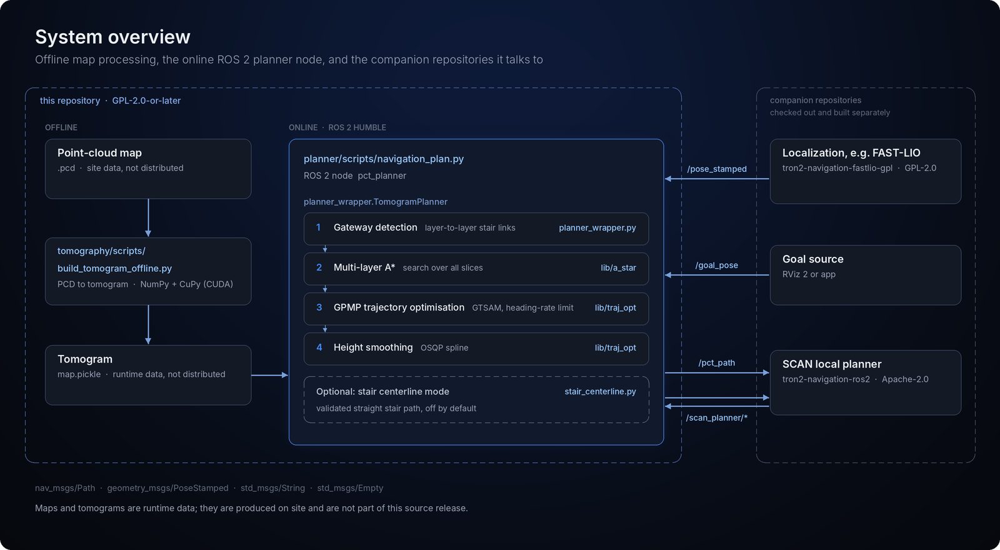
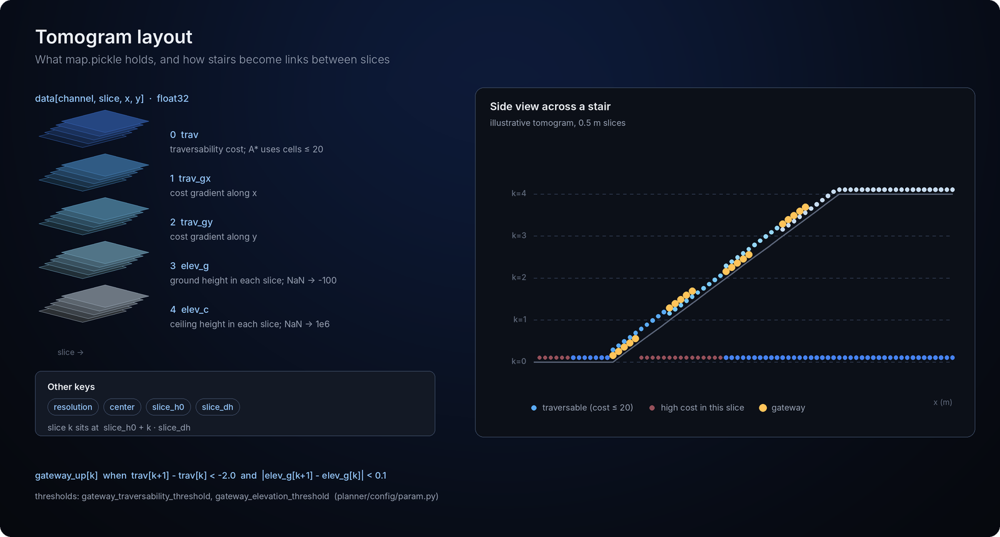
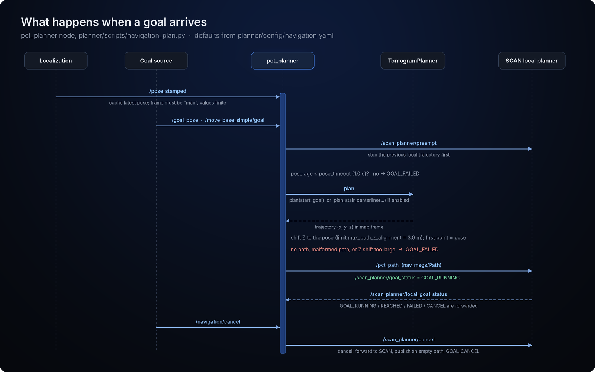

<p align="center">
  
</p>

<p align="center">
  <b>English</b> | <a href="README.zh-CN.md">简体中文</a>
</p>

<p align="center">
  <a href="LICENSE"></a>
  <a href="https://github.com/limxdynamics/tron2-navigation-pct-gpl/actions/workflows/ci.yml"></a>
  
  
  
  <a href="https://github.com/limxdynamics/tron2-navigation-pct-gpl/tags"></a>
  <a href="https://ieeexplore.ieee.org/document/10531813"></a>
</p>

# TRON2 PCT Planner

The point-cloud-tomography (PCT) global planner that lets LimX TRON2 plan one path across stairs and multiple floors, packaged as a ROS 2 Humble node for aarch64.

> This repository is the GPL-2.0-or-later planner component of TRON2 navigation. The navigation integration and local planner live in [tron2-navigation-ros2](https://github.com/limxdynamics/tron2-navigation-ros2), and localization in [tron2-navigation-fastlio-gpl](https://github.com/limxdynamics/tron2-navigation-fastlio-gpl).

## Highlights

- **One path across floors.** The map is sliced into stacked height layers, and stairs become gateway links between them, so a single A\* search finds routes that change floors.
- **Smooth, trackable output.** The grid path is refined by GPMP trajectory optimisation in GTSAM with a heading-rate limit, then height-smoothed with OSQP.
- **A strict ROS 2 node.** `geometry_msgs/PoseStamped` in, `nav_msgs/Path` out; goals in the wrong frame or with a stale pose are rejected rather than guessed.
- **Ready for the robot.** Build scripts target Ubuntu 22.04 aarch64, and an offline tool turns a `.pcd` map into a tomogram with CUDA/CuPy on the NX.
- **Opt-in stair centerline mode.** A validated straight staircase path for maintenance use, off by default and bounded by explicit limits.
- **Auditable source.** Every file is SHA-256 locked, one script audits the tree, and retained dependencies are compared byte-for-byte with the pinned upstream commit.

## What is in this repository

| Component | Path | What it does | Language |
| --- | --- | --- | --- |
| ROS 2 navigation node | `planner/scripts/navigation_plan.py` | Subscribes to pose and goal, publishes `/pct_path` and goal status | Python, `rclpy` |
| Planner wrapper | `planner/scripts/planner_wrapper.py` | Loads `map.pickle`, detects gateways, selects layers, runs plan and optimisation | Python |
| Stair centerline | `planner/scripts/stair_centerline.py` | Opt-in validated straight staircase path | Python, NumPy |
| Planner core | `planner/lib/src/` | Multi-layer A\*, GPMP optimiser, height smoother, elevation map | C++14, pybind11 |
| Offline tomography | `tomography/scripts/build_tomogram_offline.py` | Builds a tomogram from a `.pcd` map without ROS | Python, CuPy (CUDA) |
| Map tools | `tomography/scripts/` | Goal editor, tomogram publisher, chunked transfer, MROS keyframe-map extraction | Python |
| Retained dependencies | `planner/lib/3rdparty/` | GTSAM 4.1.1 (with Eigen), OSQP 0.6.2, pybind11 | C/C++ |
| RViz 2 layout | `rsc/rviz/pct_ros2.rviz` | Ready-made RViz 2 configuration | RViz |

<p align="center">
  
  <br>
  <sub>PCT planning in multi-layer scenes: paths through the scene (top) and the tomogram slices with their cost maps (bottom). Figure from the upstream <a href="https://github.com/byangw/PCT_planner">PCT_planner</a> project.</sub>
</p>

## How it works

<p align="center">
  
</p>

A point-cloud map is turned offline into a tomogram (`map.pickle`). At runtime the `pct_planner` node loads it once, takes the latest localization pose as the start, and for each goal runs gateway detection, multi-layer A\*, GPMP trajectory optimisation and height smoothing. The resulting path goes to the SCAN local planner in [tron2-navigation-ros2](https://github.com/limxdynamics/tron2-navigation-ros2).

The banner at the top shows a path this planner produced on an illustrative three-floor tomogram: ground floor, two ramps and two upper floors, eight layer changes, with search and optimisation finishing in under 30 ms on a 2-core x86 cloud machine.

### The tomogram

<p align="center">
  
</p>

`map.pickle` stores a `float32` array `data[channel, slice, x, y]` plus `resolution`, `center`, `slice_h0` and `slice_dh`. Each slice holds the ground and ceiling height visible at that level, so the same staircase cell can appear in two neighbouring slices. Where its cost drops from one slice to the next at the same ground height, the planner marks a gateway, and A\* may change layer only there. The thresholds are `gateway_traversability_threshold` (2.0) and `gateway_elevation_threshold` (0.1) in [planner/config/param.py](planner/config/param.py); A\* only enters cells with cost up to `astar_cost_threshold` (20).

## Quick start (30 seconds, no ROS)

Verify the source release and run the ROS-free planner tests. Only Git, `file`, `sha256sum`, Python 3 and NumPy are needed.

```bash
git clone https://github.com/limxdynamics/tron2-navigation-pct-gpl.git
cd tron2-navigation-pct-gpl
./audit_source.sh                      # prints GPL_SOURCE_AUDIT=PASS unit=PCT_PLANNER
pip install numpy
PYTHONDONTWRITEBYTECODE=1 python3 -m unittest discover -s planner/tests -p 'test_stair_centerline.py'
```

`PYTHONDONTWRITEBYTECODE=1` keeps `__pycache__` out of the tree, so `./audit_source.sh` still passes afterwards. For the full planner, continue with the build below.

## Build on Ubuntu 22.04 aarch64

Prerequisites include ROS 2 Humble, Python 3.10, CMake, a C++ compiler, NumPy,
SciPy, Open3D, transforms3d, and CUDA/CuPy when generating tomograms on the NX.
Build the retained third-party libraries and planner extensions from the
repository root:

```bash
./planner/build_thirdparty.sh
BUILD_JOBS=2 ./planner/build.sh
```

The build scripts write generated output only under ignored build/install paths
or as ignored extension modules. Run the included tests before deployment:

```bash
PYTHONDONTWRITEBYTECODE=1 python3 -m unittest discover -s planner/tests -p 'test_*.py'
PYTHONDONTWRITEBYTECODE=1 python3 -m unittest discover -s tomography/tests -p 'test_*.py'
```

Notes:

- GTSAM builds with system Eigen (`GTSAM_USE_SYSTEM_EIGEN=ON`), so the Boost and Eigen development packages must be installed, for example `libboost-all-dev` and `libeigen3-dev`.
- `build_thirdparty.sh` builds only the GTSAM core library; GTSAM examples and `gtsam_unstable`, which the planner does not use, are skipped. On a 2-core x86 machine the third-party build takes about 8 minutes.
- `test_multilayer_astar_state.py` imports the built `a_star` extension, and two tomography tests import ROS 2 message packages, so run the full test set after the build in a sourced ROS 2 Humble shell. `test_keyframe_height_filter.py` also needs the `rosbags` Python package.
- Use NumPy 1.x (`numpy<2`), such as the `python3-numpy` that ships with Ubuntu 22.04. The bundled pybind11 2.11.0.dev1 predates NumPy 2 support; importing the extensions under NumPy 2 now stops with a clear `ImportError` instead of crashing. With Python 3.10 and NumPy 1.x all ten planner tests pass.
- `PYTHONDONTWRITEBYTECODE=1` keeps `__pycache__` directories out of the tree; `./audit_source.sh` rejects them as generated content.

## ROS 2 runtime

Provide a separately generated and validated tomogram; maps are runtime data and
are intentionally not distributed here. Then source ROS 2 Humble and start the
planner:

```bash
export PCT_TOMOGRAM=/absolute/path/to/map.pickle
./planner/run_navigation_humble.sh
```

The navigation wrapper consumes standard pose/goal messages and publishes
`nav_msgs/Path` on `/pct_path`. The permissive integration repository and the
FAST-LIO GPL repository are checked out and built separately. This process-level
engineering separation does not change any component's license.

Companion repositories:

- <https://github.com/limxdynamics/tron2-navigation-ros2>
- <https://github.com/limxdynamics/tron2-navigation-fastlio-gpl>

<p align="center">
  
</p>

### Topics and parameters

Defaults from [planner/config/navigation.yaml](planner/config/navigation.yaml):

| Parameter | Default | Role |
| --- | --- | --- |
| `frame_id` | `map` | Pose and goal must be in this frame; no implicit TF is applied |
| `pose_topic` | `/pose_stamped` | Localization pose (`geometry_msgs/PoseStamped`) |
| `goal_topic` / `legacy_goal_topic` | `/goal_pose` / `/move_base_simple/goal` | Goal pose (`geometry_msgs/PoseStamped`) |
| `path_topic` | `/pct_path` | Planned path (`nav_msgs/Path`, transient local) |
| `cancel_input_topic` | `/navigation/cancel` | Cancel request (`std_msgs/Empty`) |
| `cancel_output_topic` / `preempt_output_topic` | `/scan_planner/cancel` / `/scan_planner/preempt` | Cancel and preempt sent to the local planner |
| `status_topic` / `local_status_topic` | `/scan_planner/goal_status` / `/scan_planner/local_goal_status` | Goal status out (`std_msgs/String`) and local-planner status in |
| `pose_timeout` | `1.0` | Maximum pose age in seconds when a goal arrives |
| `start_layer` / `goal_layer` | `-1` | Force a tomogram layer; `-1` selects it from the pose height |
| `path_height_offset` | `0.5` | Height added to the ground to form the body path |
| `align_path_z_to_pose` / `max_path_z_alignment` | `true` / `3.0` | Shift the path Z to the current pose, within this limit |

## v1.1.0 stair centerline mode

The planner wrapper includes an opt-in stair centerline mode. When it is
enabled, PCT A\* is bypassed: the wrapper reconstructs one XY-straight path from
the tomogram layer geometry, validates cell cost, support error, support
continuity, layer continuity, XY length, and vertical span, then smooths the
supported centerline. Invalid or ambiguous inputs fail closed: the node
publishes an empty path and reports `GOAL_FAILED`, and it does not fall back to
an A\* path. The feature never invents an unvalidated route.

Enable it with `pct_planner.stair_centerline.enabled=true`. The associated
limits are in [planner/config/navigation.yaml](planner/config/navigation.yaml).
The companion permissive integration exposes this only through its explicitly
confirmed no-local-obstacle-avoidance maintenance mode, with bounded speed and
a paused start. That operational restriction does not replace site validation.

| Parameter | Default |
| --- | --- |
| `stair_centerline.enabled` | `false` |
| `stair_centerline.max_cost` | `20.0` |
| `stair_centerline.max_support_error` | `0.25` |
| `stair_centerline.max_support_step` | `0.30` |
| `stair_centerline.max_layer_step` | `1` |
| `stair_centerline.smoothing_window` | `9` |
| `stair_centerline.minimum_xy_length` | `0.5` |
| `stair_centerline.minimum_vertical_span` | `0.5` |

## Source integrity and license

`SOURCE_INVENTORY.sha256` locks every distributed file except itself.
`./audit_source.sh` verifies the inventory, required GPL and third-party license
texts, source-only contents, privacy exclusions, and path constraints.

PCT is GPL-2.0-or-later. Embedded dependencies remain under their own terms,
including BSD-3-Clause, Apache-2.0, BSD-style, MPL-2.0, and retained per-file
BSD/LGPL notices. The software is provided without warranty.

## About this source release

This repository publishes the complete source for the modified PCT global
planner used by the LimX ROS 2 navigation integration. It is derived from
[PCT_planner](https://github.com/byangw/PCT_planner) commit
`35cd73fd82bcd51bc538429294af7646b2a09815` and is distributed under GNU GPL
version 2 or, at your option, any later version.

The repository contains the ROS 2 Humble/aarch64 planner, Python wrapper,
pybind11 extensions, tomography tools, build scripts, regression tests, and the
source and notices for retained GTSAM, OSQP/QDLDL, pybind11, and Eigen
snapshots. Read [NOTICE](NOTICE) and [PROVENANCE.md](PROVENANCE.md) before
redistributing it.

## Source snapshot

This repository contains the complete PCT derivative source expected by the
companion LimX ROS 2 navigation integration. Two retained `.gitignore`
exceptions ensure that the offline OSQP/QDLDL configuration headers remain
tracked as corresponding source.

## Dependency provenance

[PROVENANCE.md](PROVENANCE.md) records file counts, exact baseline hashes, and
local differences for all retained third-party source. To reproduce the
byte-level comparison, provide a separate upstream PCT clone containing the
pinned commit:

```bash
./tools/verify_pct_dependency_provenance.sh /path/to/upstream/PCT_planner
```

The script performs no network access.
