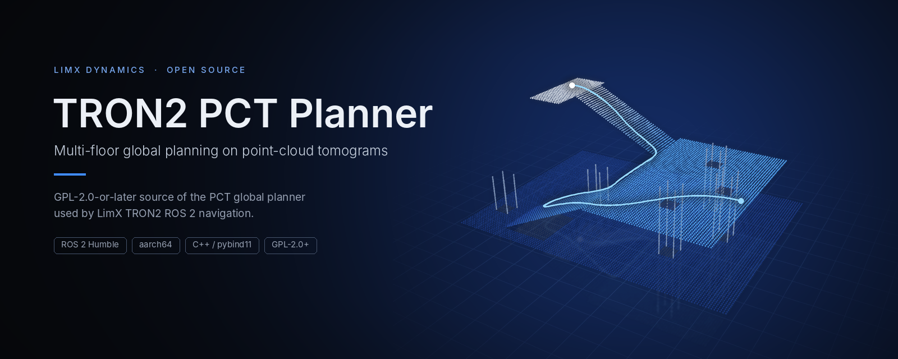
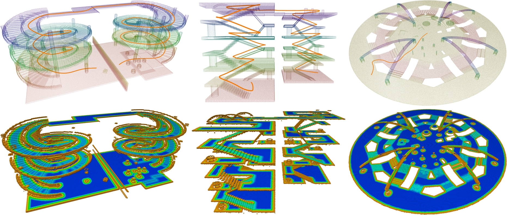
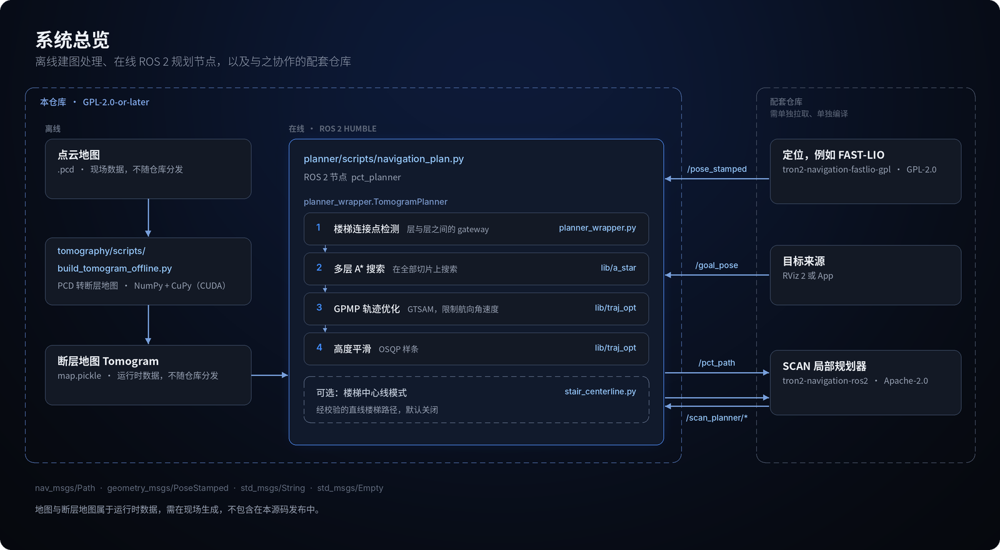
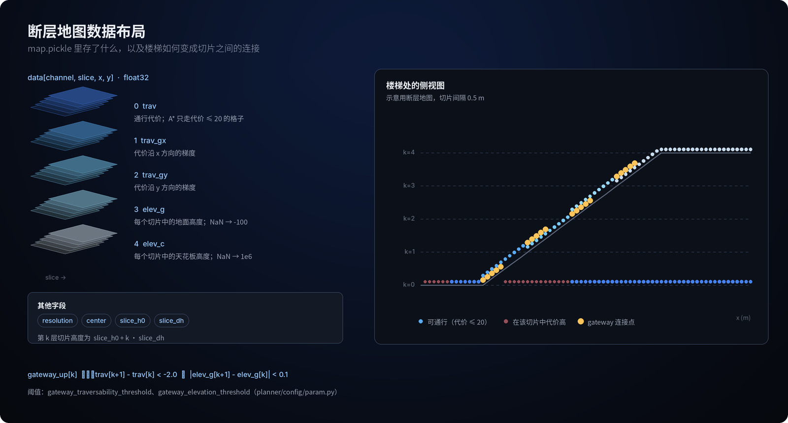
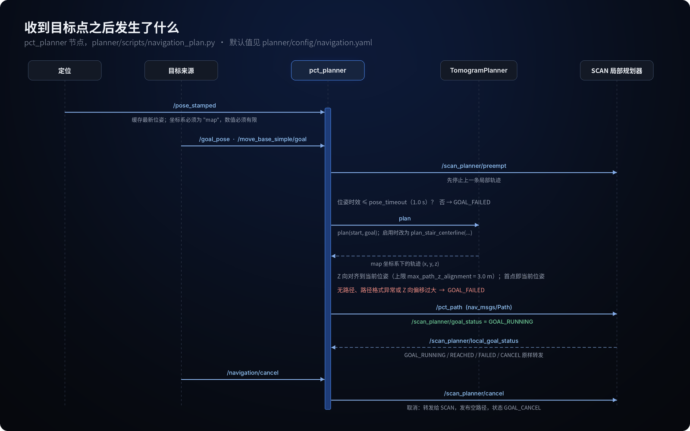

<p align="center">
  
</p>

<p align="center">
  <a href="README.md">English</a> | <b>简体中文</b>
</p>

<p align="center">
  <a href="LICENSE"></a>
  
  
  
  <a href="https://github.com/limxdynamics/tron2-navigation-pct-gpl/tags"></a>
  <a href="https://ieeexplore.ieee.org/document/10531813"></a>
</p>

# TRON2 PCT Planner

基于点云断层（Point Cloud Tomography，PCT）的全局规划器，让 LimX TRON2 能规划一条跨越楼梯、贯穿多个楼层的路径；以 ROS 2 Humble 节点形式提供，面向 aarch64。

> 本仓库是 TRON2 导航中采用 GPL-2.0-or-later 许可的规划器组件。导航集成与局部规划器位于 [tron2-navigation-ros2](https://github.com/limxdynamics/tron2-navigation-ros2)，定位位于 [tron2-navigation-fastlio-gpl](https://github.com/limxdynamics/tron2-navigation-fastlio-gpl)。

## 亮点

- **一条路径跨越楼层。** 地图被切分成按高度堆叠的切片层，楼梯成为层与层之间的 gateway 连接点，一次 A\* 搜索即可得到换层路线。
- **路径平滑、便于跟踪。** 栅格路径先经 GTSAM 中的 GPMP 轨迹优化（带航向角速度约束），再由 OSQP 做高度平滑。
- **严格的 ROS 2 节点。** 输入 `geometry_msgs/PoseStamped`，输出 `nav_msgs/Path`；坐标系不符或位姿过期的目标会被直接拒绝，不做猜测。
- **面向实机。** 编译脚本针对 Ubuntu 22.04 aarch64；离线工具可在 NX 上用 CUDA/CuPy 把 `.pcd` 地图转成断层地图。
- **可选的楼梯中心线模式。** 用于维护场景的经校验直线楼梯路径，默认关闭，并受明确的阈值约束。
- **源码可审计。** 每个文件都有 SHA-256 锁定，一个脚本即可审计整棵源码树，保留的第三方依赖与上游固定提交逐字节比对。

## 仓库组成一览

| 组件 | 路径 | 作用 | 语言 |
| --- | --- | --- | --- |
| ROS 2 导航节点 | `planner/scripts/navigation_plan.py` | 订阅位姿与目标点，发布 `/pct_path` 和目标状态 | Python，`rclpy` |
| 规划器封装 | `planner/scripts/planner_wrapper.py` | 加载 `map.pickle`，检测 gateway，选择层，执行规划与优化 | Python |
| 楼梯中心线 | `planner/scripts/stair_centerline.py` | 可选的经校验直线楼梯路径 | Python，NumPy |
| 规划器核心 | `planner/lib/src/` | 多层 A\*、GPMP 优化器、高度平滑器、高程地图 | C++14，pybind11 |
| 离线断层建图 | `tomography/scripts/build_tomogram_offline.py` | 不依赖 ROS，由 `.pcd` 地图生成断层地图 | Python，CuPy（CUDA） |
| 地图工具 | `tomography/scripts/` | 目标点编辑、断层地图发布、分块传输、MROS 关键帧地图提取 | Python |
| 保留的第三方依赖 | `planner/lib/3rdparty/` | GTSAM 4.1.1（含 Eigen）、OSQP 0.6.2、pybind11 | C/C++ |
| RViz 2 配置 | `rsc/rviz/pct_ros2.rviz` | 现成的 RViz 2 显示配置 | RViz |

<p align="center">
  
  <br>
  <sub>PCT 在多层场景中的规划效果：上排为场景中的路径，下排为断层切片及其代价图。图片来自上游 <a href="https://github.com/byangw/PCT_planner">PCT_planner</a> 项目。</sub>
</p>

## 工作原理

<p align="center">
  
</p>

点云地图先离线转换为断层地图（`map.pickle`）。运行时 `pct_planner` 节点加载一次地图，以最新的定位位姿为起点，对每个目标依次执行 gateway 检测、多层 A\*、GPMP 轨迹优化和高度平滑，得到的路径交给 [tron2-navigation-ros2](https://github.com/limxdynamics/tron2-navigation-ros2) 中的 SCAN 局部规划器。

页首横幅中的路径由本规划器在一张示意用的三层断层地图上实际生成：地面层、两段坡道和两个上层楼面，共换层 8 次，在 2 核 x86 云主机上搜索加优化用时不到 30 ms。

### 断层地图

<p align="center">
  
</p>

`map.pickle` 中保存一个 `float32` 数组 `data[channel, slice, x, y]`，以及 `resolution`、`center`、`slice_h0`、`slice_dh` 四个字段。每个切片记录该高度上可见的地面高度和天花板高度，因此同一个楼梯格子可能同时出现在相邻两层。若该格子在同一地面高度下、从一层到上一层的代价明显下降，规划器就把它标记为 gateway，A\* 只能在这些位置换层。相关阈值是 [planner/config/param.py](planner/config/param.py) 中的 `gateway_traversability_threshold`（2.0）和 `gateway_elevation_threshold`（0.1）；A\* 只进入代价不超过 `astar_cost_threshold`（20）的格子。

## 30 秒快速开始（无需 ROS）

校验源码发布并运行不依赖 ROS 的规划器测试。只需要 Git、`file`、`sha256sum`、Python 3 和 NumPy。

```bash
git clone https://github.com/limxdynamics/tron2-navigation-pct-gpl.git
cd tron2-navigation-pct-gpl
./audit_source.sh                      # 输出 GPL_SOURCE_AUDIT=PASS unit=PCT_PLANNER
pip install numpy
PYTHONDONTWRITEBYTECODE=1 python3 -m unittest discover -s planner/tests -p 'test_stair_centerline.py'
```

`PYTHONDONTWRITEBYTECODE=1` 可避免在源码树中生成 `__pycache__`，之后再运行 `./audit_source.sh` 仍能通过。如需完整的规划器，请继续下面的编译步骤。

## 在 Ubuntu 22.04 aarch64 上编译

依赖包括 ROS 2 Humble、Python 3.10、CMake、C++ 编译器、NumPy、SciPy、Open3D、transforms3d；在 NX 上生成断层地图还需要 CUDA/CuPy。在仓库根目录编译保留的第三方库和规划器扩展：

```bash
./planner/build_thirdparty.sh
BUILD_JOBS=2 ./planner/build.sh
```

编译脚本只会把产物写入已被忽略的 build/install 目录，或生成已被忽略的扩展模块。部署前请运行自带测试：

```bash
python3 -m unittest discover -s planner/tests -p 'test_*.py'
python3 -m unittest discover -s tomography/tests -p 'test_*.py'
```

说明：

- GTSAM 使用系统 Eigen 编译（`GTSAM_USE_SYSTEM_EIGEN=ON`），需要预先安装 Boost 和 Eigen 的开发包，例如 `libboost-all-dev` 和 `libeigen3-dev`。
- `test_multilayer_astar_state.py` 依赖编译出的 `a_star` 扩展，另有两个 tomography 测试依赖 ROS 2 消息包，因此完整测试需要在编译完成后、并已 source ROS 2 Humble 的终端中运行。`test_keyframe_height_filter.py` 还需要 Python 包 `rosbags`。
- 请按上文使用 Python 3.10。随附的 pybind11 2.11.0.dev1 扩展在 Python 3.13 + NumPy 2 下能编译和导入，但调用 `a_star.Astar.init` 时崩溃；在 Python 3.10 + NumPy 1.x 下全部 10 个规划器测试通过。
- 运行测试会生成 `__pycache__` 目录，`./audit_source.sh` 会把它们识别为生成内容而报错，审计前请先删除。

## ROS 2 运行

请自行生成并验证断层地图；地图属于运行时数据，有意不随本仓库分发。然后 source ROS 2 Humble 并启动规划器：

```bash
export PCT_TOMOGRAM=/absolute/path/to/map.pickle
./planner/run_navigation_humble.sh
```

导航封装订阅标准的位姿和目标消息，并在 `/pct_path` 上发布 `nav_msgs/Path`。宽松许可的集成仓库与 FAST-LIO GPL 仓库需单独拉取、单独编译。许可证相关的原文表述如下：

> This process-level engineering separation does not change any component's license.

配套仓库：

- <https://github.com/limxdynamics/tron2-navigation-ros2>
- <https://github.com/limxdynamics/tron2-navigation-fastlio-gpl>

<p align="center">
  
</p>

### 话题与参数

默认值见 [planner/config/navigation.yaml](planner/config/navigation.yaml)：

| 参数 | 默认值 | 作用 |
| --- | --- | --- |
| `frame_id` | `map` | 位姿与目标必须在该坐标系下；不做隐式 TF 变换 |
| `pose_topic` | `/pose_stamped` | 定位位姿（`geometry_msgs/PoseStamped`） |
| `goal_topic` / `legacy_goal_topic` | `/goal_pose` / `/move_base_simple/goal` | 目标位姿（`geometry_msgs/PoseStamped`） |
| `path_topic` | `/pct_path` | 规划结果（`nav_msgs/Path`，transient local） |
| `cancel_input_topic` | `/navigation/cancel` | 取消请求（`std_msgs/Empty`） |
| `cancel_output_topic` / `preempt_output_topic` | `/scan_planner/cancel` / `/scan_planner/preempt` | 发给局部规划器的取消与抢占 |
| `status_topic` / `local_status_topic` | `/scan_planner/goal_status` / `/scan_planner/local_goal_status` | 对外发布的目标状态（`std_msgs/String`）与来自局部规划器的状态 |
| `pose_timeout` | `1.0` | 收到目标时允许的最大位姿时效（秒） |
| `start_layer` / `goal_layer` | `-1` | 强制指定断层层号；`-1` 表示根据位姿高度自动选择 |
| `path_height_offset` | `0.5` | 在地面高度上叠加的机体路径高度 |
| `align_path_z_to_pose` / `max_path_z_alignment` | `true` / `3.0` | 将路径 Z 对齐到当前位姿，偏移不超过该上限 |

## v1.1.0 楼梯中心线模式

规划器封装包含一个默认关闭的楼梯中心线后处理功能，通过 `pct_planner.stair_centerline.enabled=true` 启用，相关阈值见 [planner/config/navigation.yaml](planner/config/navigation.yaml)。该功能涉及安全边界，以下为英文原文说明：

> The planner wrapper includes an opt-in stair centerline post-processor. It
> reconstructs a path from the tomogram layer geometry, validates cell cost,
> support error, support continuity, layer continuity, XY length, and vertical
> span, then smooths the supported centerline. Invalid or ambiguous inputs fail
> closed to the original planner path; the feature never invents an unvalidated
> route.
>
> Enable it with `pct_planner.stair_centerline.enabled=true`. The associated
> limits are in [planner/config/navigation.yaml](planner/config/navigation.yaml).
> The companion permissive integration exposes this only through its explicitly
> confirmed no-local-obstacle-avoidance maintenance mode, with bounded speed and
> a paused start. That operational restriction does not replace site validation.

| 参数 | 默认值 |
| --- | --- |
| `stair_centerline.enabled` | `false` |
| `stair_centerline.max_cost` | `20.0` |
| `stair_centerline.max_support_error` | `0.25` |
| `stair_centerline.max_support_step` | `0.30` |
| `stair_centerline.max_layer_step` | `1` |
| `stair_centerline.smoothing_window` | `9` |
| `stair_centerline.minimum_xy_length` | `0.5` |
| `stair_centerline.minimum_vertical_span` | `0.5` |

## 源码完整性与许可证

以下许可证与合规说明保留英文原文，以英文表述为准。

### Source integrity and license

`SOURCE_INVENTORY.sha256` locks every distributed file except itself.
`./audit_source.sh` verifies the inventory, required GPL and third-party license
texts, source-only contents, privacy exclusions, and path constraints.

PCT is GPL-2.0-or-later. Embedded dependencies remain under their own terms,
including BSD-3-Clause, Apache-2.0, BSD-style, MPL-2.0, and retained per-file
BSD/LGPL notices. The software is provided without warranty.

## 关于本源码发布

### About this source release

This repository publishes the complete source for the modified PCT global
planner used by the LimX ROS 2 navigation integration. It is derived from
[PCT_planner](https://github.com/byangw/PCT_planner) commit
`35cd73fd82bcd51bc538429294af7646b2a09815` and is distributed under GNU GPL
version 2 or, at your option, any later version.

The repository contains the ROS 2 Humble/aarch64 planner, Python wrapper,
pybind11 extensions, tomography tools, build scripts, regression tests, and the
source and notices for retained GTSAM, OSQP/QDLDL, pybind11, and Eigen
snapshots. Read [NOTICE](NOTICE) and [PROVENANCE.md](PROVENANCE.md) before
redistributing it.

## 源码快照

### Source snapshot

This repository contains the complete PCT derivative source expected by the
companion LimX ROS 2 navigation integration. Two retained `.gitignore`
exceptions ensure that the offline OSQP/QDLDL configuration headers remain
tracked as corresponding source.

## 依赖来源

### Dependency provenance

[PROVENANCE.md](PROVENANCE.md) records file counts, exact baseline hashes, and
local differences for all retained third-party source. To reproduce the
byte-level comparison, provide a separate upstream PCT clone containing the
pinned commit:

```bash
./tools/verify_pct_dependency_provenance.sh /path/to/upstream/PCT_planner
```

The script performs no network access.
